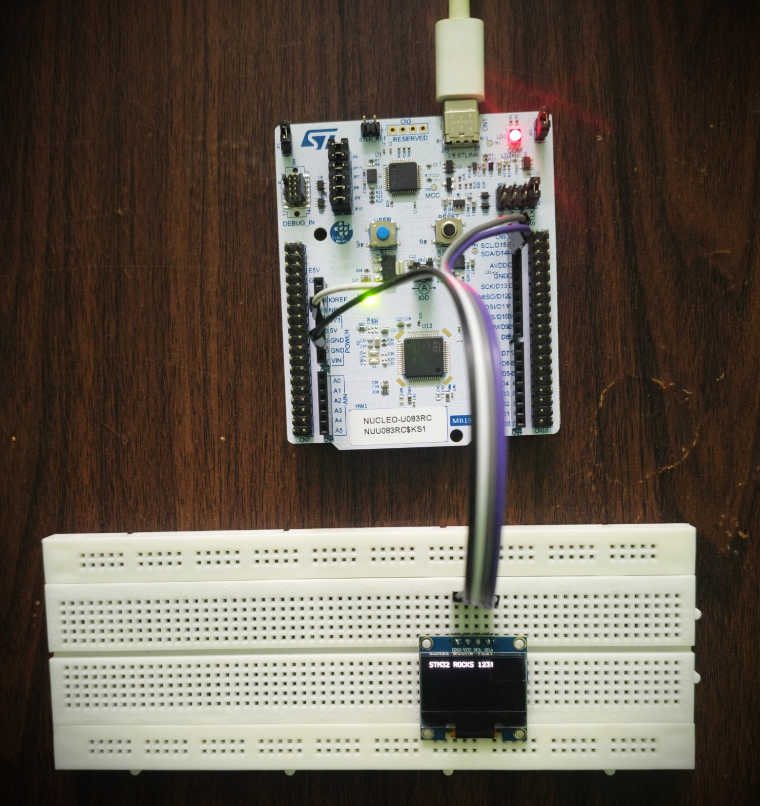

# I²C + SSD1306 OLED Driver — STM32U083RC

Register-level I²C1 master driver and SSD1306 128×64 OLED driver for the **STM32 NUCLEO-U083RC**, written in bare-metal C without STM32 HAL.

Includes a custom 5×7 ASCII font for character and string rendering.

---

## Hardware Setup

<p align="center">
  
</p>

*OLED displaying "STM32ROCKS 123!" rendered with the custom 5×7 font table.*

---

## What It Demonstrates

- I²C1 master transmit driver built directly on peripheral registers
- Hardware-managed transfer length using the `NBYTES` field
- Flag-based transfer handling: `BUSY`, `TXIS`, `NACKF`, `TC`
- SSD1306 initialization, screen clear, cursor positioning
- Character and string rendering from a 5×7 font table
- Driver layering: I²C driver, then SSD1306 driver, then font table

---

## Configuration

| Item | Value |
|---|---|
| Peripheral | I2C1 |
| SCL / SDA | PB8 / PB9 |
| GPIO mode | Alternate function AF4, open-drain |
| OLED address | `0x3C` |
| Timing register | `0x00303D5B` |

| SSD1306 Pin | Connection |
|---|---|
| VCC | 3.3 V |
| GND | GND |
| SCL | PB8 |
| SDA | PB9 |

---

## I²C Transfer Sequence

`I2C1_Send()` performs a complete master write:

```
Check BUSY → set slave address and write direction → set NBYTES
      ↓
Generate START → wait for TXIS (or NACKF = error)
      ↓
Send data bytes → wait for TC → generate STOP
```

The peripheral counts transmitted bytes from `NBYTES` in `I2C_CR2` and sets `TC` when the transfer is complete.

---

## SSD1306 and Font Rendering

Each transmission starts with a control byte: `0x00` for a command, `0x40` for display data.

Characters are drawn from a table covering ASCII 32 to 126, five bytes per character, with each byte driving one vertical column of pixels:

```
ASCII value − 32 → font table index → 5-byte bitmap → SSD1306 data
```

One blank column is added after each character, so each character occupies 6 columns.

---

## Project Structure

```
I2C_SSD1306_OLED/
├── Images/
└── I2C_OLED_Driver_Modular/
    └── Sources/
        ├── main.c
        ├── registers.h
        ├── i2c.c / i2c.h
        ├── ssd1306.c / ssd1306.h
        └── font5x7.c / font5x7.h
```

---

## Notes

- This driver is reused in the Visitor Counter and Industrial Environment Monitor projects. It was later extended there with write-then-read transfers and timeout handling so it can also talk to an EEPROM and RTC on the same bus.
- Transmit only. The I²C receive path was added in the later projects.

**Tools:** STM32CubeIDE · ARM GCC · Git