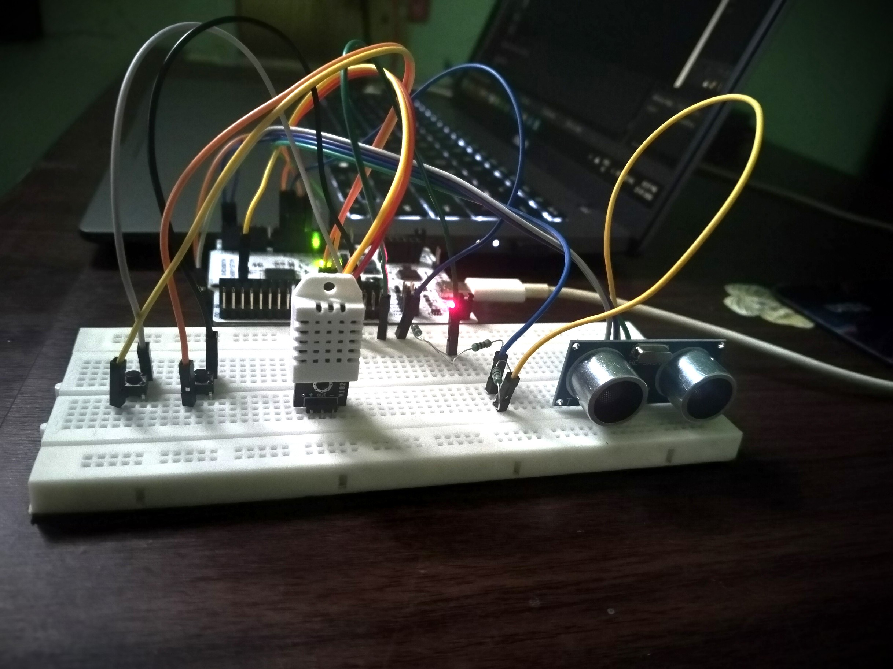
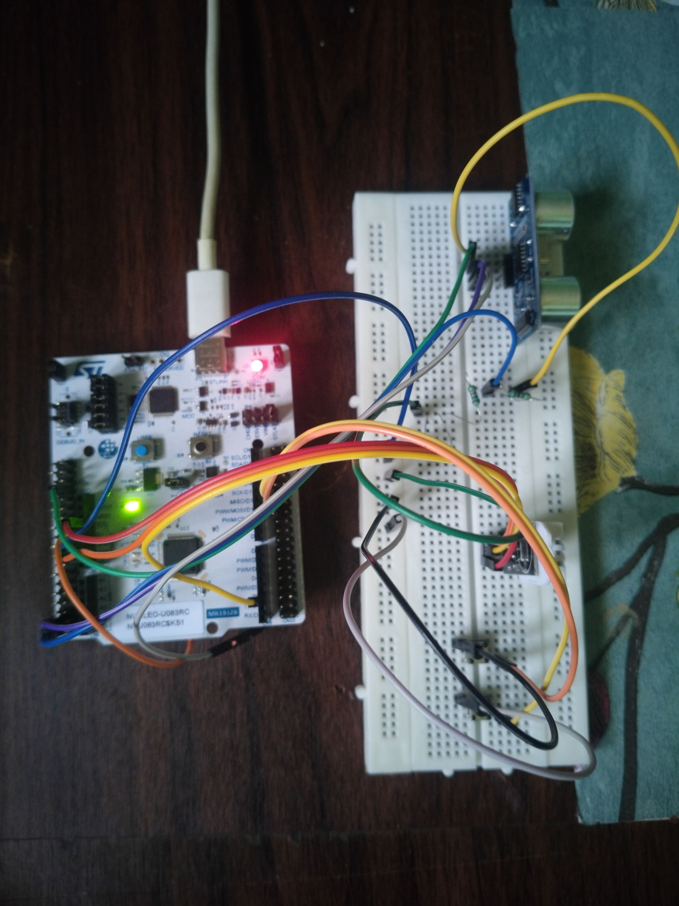
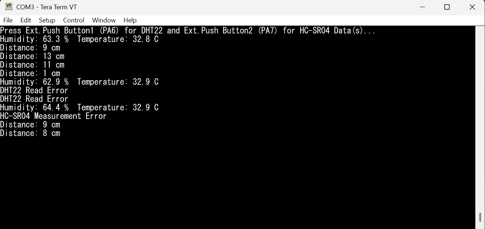

# Sensor Drivers — DHT22 and HC-SR04 — STM32U083RC

Register-level drivers for the **DHT22** temperature and humidity sensor and the **HC-SR04** ultrasonic distance sensor on the **STM32 NUCLEO-U083RC**, written in bare-metal C without STM32 HAL.

Both sensor drivers share one reusable **TIM3 microsecond timer** driver. Readings are triggered by push buttons and printed over USART2.

---

## Hardware Setup

<p align="center">
  
</p>

<p align="center">
  
</p>

---

## UART Output

<p align="center">
  
</p>

---

## What It Demonstrates

- **Shared 1 µs timer driver** — TIM3 (prescaler 3, auto-reload 65535) used for both DHT22 bit timing and HC-SR04 pulse measurement
- **DHT22 single-wire protocol** — start signal, response detection and 40-bit read by measuring pulse widths, with the data pin switching between output and input at runtime
- **Checksum validation** — packet accepted only if the sum of the first four bytes matches the fifth
- **Timeout handling** — a missing sensor response or echo cannot lock the firmware
- **Drivers separated from application** — UART, timer, button, DHT22 and HC-SR04 are independent modules

---

## How It Works

**DHT22:** the MCU pulls the line low to start, releases it, then reads 40 bits. The high-pulse width of each bit decides 0 or 1.

| Byte | Content |
|---|---|
| 0 and 1 | Humidity × 10 |
| 2 and 3 | Temperature × 10, top bit is the sign |
| 4 | Checksum |

**HC-SR04:** a 10 µs trigger pulse is sent, the echo high time is measured with TIM3, and distance in cm is the pulse width in µs divided by 58.

**Main loop:** button 1 triggers a DHT22 read, button 2 triggers a distance measurement, and each result is sent over UART.

---

## Configuration

| Item | Value |
|---|---|
| UART | USART2, 115200 baud |
| DHT22 data | PA10 |
| HC-SR04 trigger / echo | PC2 / PC3 |
| Buttons | PA6, PA7 |

HC-SR04 is powered from 5 V. Its echo output is 5 V, so it reaches the STM32 through a **voltage divider** to stay within 3.3 V logic levels.

---

## Project Structure

```
STM32_Sensor_Drivers/
├── Images/
└── Sensor_Driver_Modular/
    └── Sources/
        ├── main.c
        ├── registers.h
        ├── uart.c / uart.h
        ├── timer3.c / timer3.h
        ├── button.c / button.h
        ├── dht22.c / dht22.h
        └── hc-sr04.c / hc-sr04.h
```

---

## Notes

- Drivers are blocking and polled. The DHT22 driver were reused in the Industrial Environment Monitor, where DHT22 timing moved to a hardware timer.

**Tools:** STM32CubeIDE · ARM GCC · Tera Term · Git
