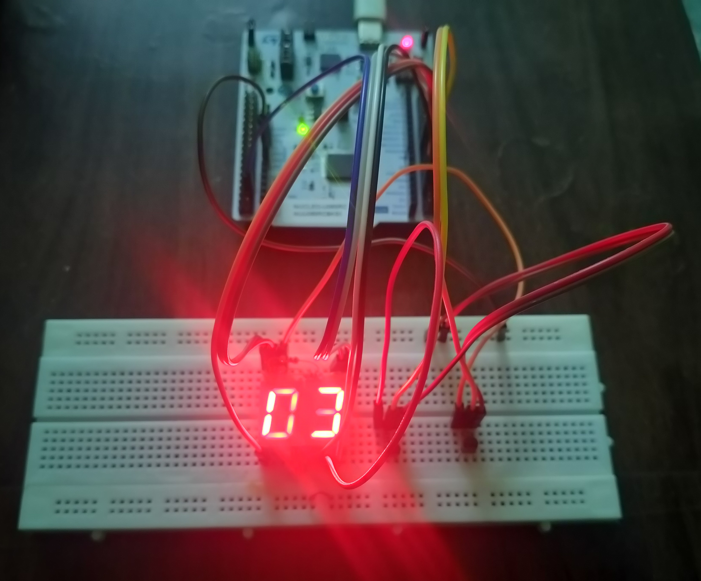

# Seven-Segment Multiplexing Driver

A register-level driver for controlling a two-digit, common-cathode seven-segment display using the **STM32 NUCLEO-U083RC** development board.

## Features

- Direct GPIO register programming without HAL.
- Two-digit multiplexing using GPIOB.
- Displays numbers from 00 to 99.
- SysTick-based 1 ms refresh interval.
- Segment lookup table for digits 0–9.
- Modular functions for GPIO initialization, number setting, display blanking, and multiplexing.

## Hardware Setup

### Pin Mapping

| STM32 Pin | Connection |
|---|---|
| PB0 | Segment A |
| PB1 | Segment B |
| PB2 | Segment C |
| PB3 | Segment D |
| PB4 | Segment E |
| PB5 | Segment F |
| PB6 | Segment G |
| PB11 | Tens digit control |
| PB12 | Ones digit control |

BC547 NPN transistors are used for digit selection. Each GPIO drives a transistor's base, the emitter connects to GND, and the collector connects to the corresponding digit's common-cathode pin.

Segment outputs are active-HIGH, and driving a digit-control pin HIGH activates its transistor.

## Driver Files

- `SevenSeg.c` – GPIO configuration, segment patterns, number handling, and multiplexing logic.
- `SevenSeg.h` – Public driver function declarations.
- `SysTick.c` / `SysTick.h` – Millisecond system tick used for display refresh timing.

## Demo

The example application counts from **00 to 99**, updating once per second while continuously refreshing the multiplexed display.

## Requirements

- STM32CubeIDE
- STM32 NUCLEO-U083RC
- Two-digit common-cathode seven-segment display
- BC547 NPN transistors
- Suitable current-limiting resistors for the segments and transistor bases

## Author

Balaji M