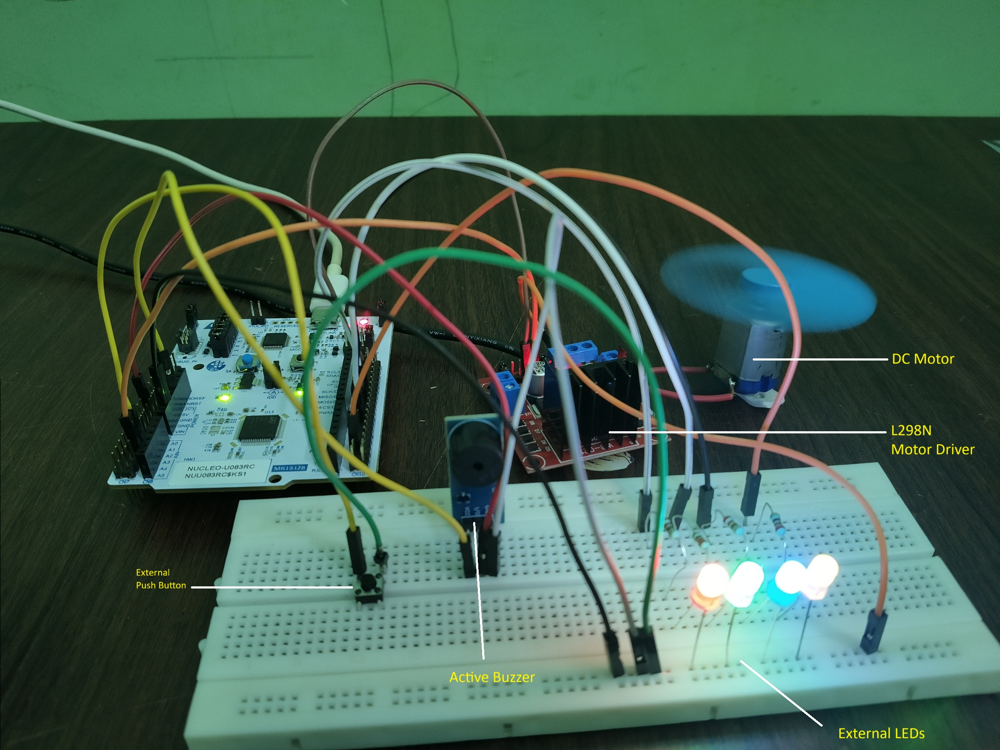
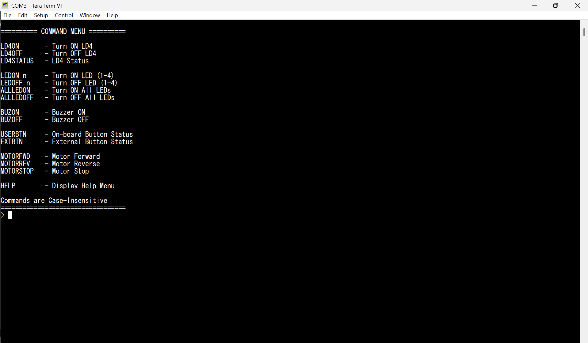
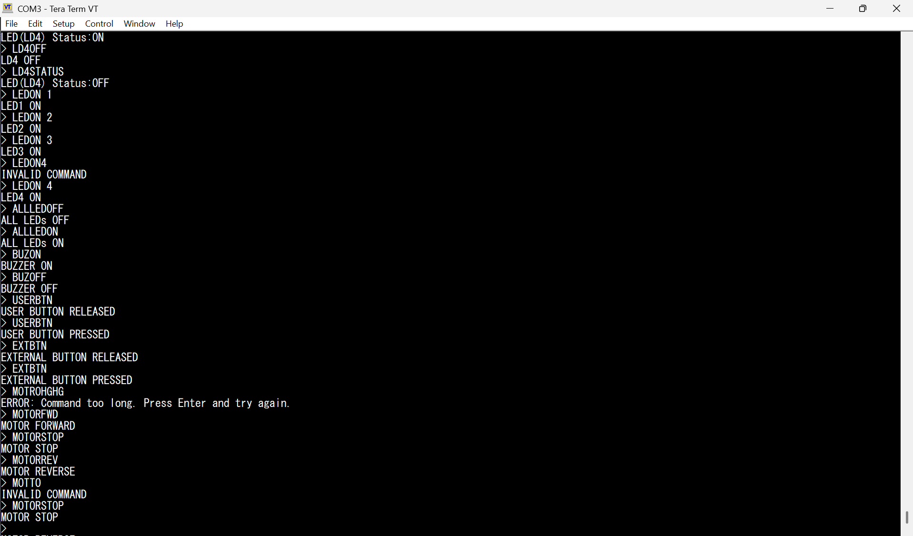
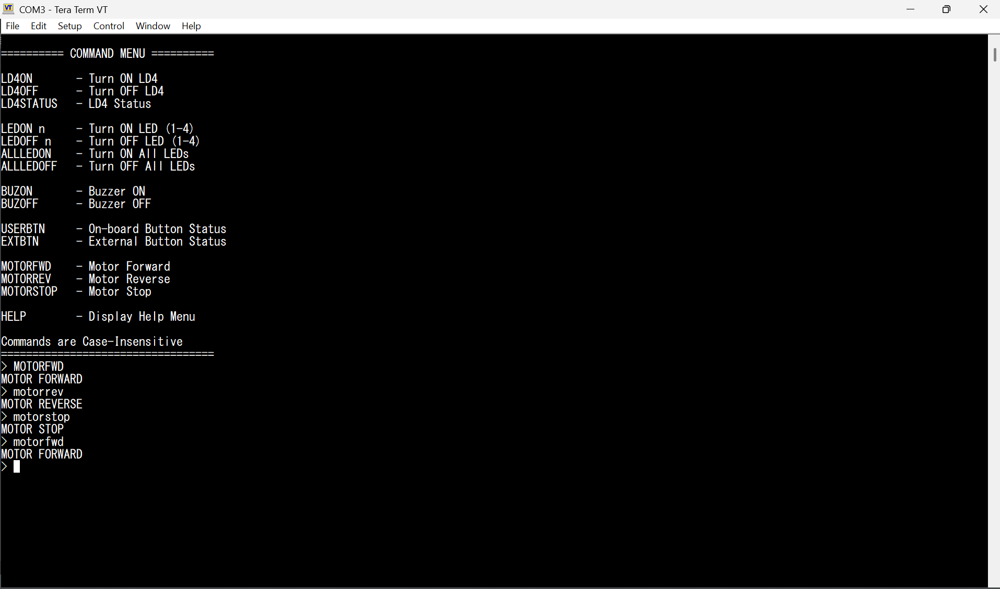

# UART Command Interface — GPIO and Motor Control — STM32U083RC

A UART command-line interface on the **STM32 NUCLEO-U083RC** for controlling LEDs, a buzzer and an L298N-driven DC motor, and for reading buttons. Written in bare-metal C using direct register programming, without STM32 HAL.

This was the first project in the repository. It established the register-level driver structure reused in later projects.

---

## Hardware Setup

<p align="center">
  
</p>

---

## UART Interface

<p align="center">
  
</p>

<p align="center">
  
</p>

<p align="center">
  
</p>

---

## What It Demonstrates

- **USART2 transmit and receive** over the ST-LINK Virtual COM Port, with no external adapter
- **String command parser**, case-insensitive, with an argument for LED number (`LEDON 3`)
- **Atomic GPIO writes** using `GPIOx_BSRR`, so pins are set or reset in one write without read-modify-write
- **Output state readback** using `GPIOx_ODR` for the status commands
- **L298N motor control**: forward, reverse and stop through two direction pins
- **Modular layout**: `uart`, `gpio` and `motor` modules with a shared `registers.h`

---

## UART Commands

| Group | Command | Action |
|---|---|---|
| On-board LED | `LD4ON` / `LD4OFF` / `LD4STATUS` | Control or read LD4 |
| External LEDs | `LEDON n` / `LEDOFF n` | Control LED 1 to 4 |
| | `ALLLEDON` / `ALLLEDOFF` | Control all four |
| Buzzer | `BUZON` / `BUZOFF` | Control buzzer |
| Buttons | `USERBTN` / `EXTBTN` | Read on-board or external button |
| Motor | `MOTORFWD` / `MOTORREV` / `MOTORSTOP` | Direction and stop |
| Help | `HELP` | List commands |

Commands are case-insensitive.

---

## Pin Mapping

| Function | Pin |
|---|---|
| On-board LED (LD4) | PA5 |
| External LEDs 1 to 4 | PA7, PA8, PA9, PA10 |
| On-board user button | PC13 |
| External button | PA1 |
| Active buzzer | PA15 |
| L298N IN1 / IN2 | PA4 / PA6 |
| USART2 | via ST-LINK Virtual COM Port |

The motor runs from a 12 V adapter connected to the L298N. The STM32 and the L298N must share a common ground.

---

## Project Structure

```
UART_GPIO_MOTOR/
├── Images/
└── UART_Driver_Modular/
    └── Sources/
        ├── main.c
        ├── registers.h
        ├── uart.c / uart.h
        ├── gpio.c / gpio.h
        └── motor.c / motor.h
```

---

## Notes

- The motor is driven on/off with direction control only. PWM speed control was added later in the Industrial Environment Monitor.
- Buttons are read by command (polled). Interrupt-driven input is covered in the EXTI driver.

**Tools:** STM32CubeIDE · Tera Term · Git
