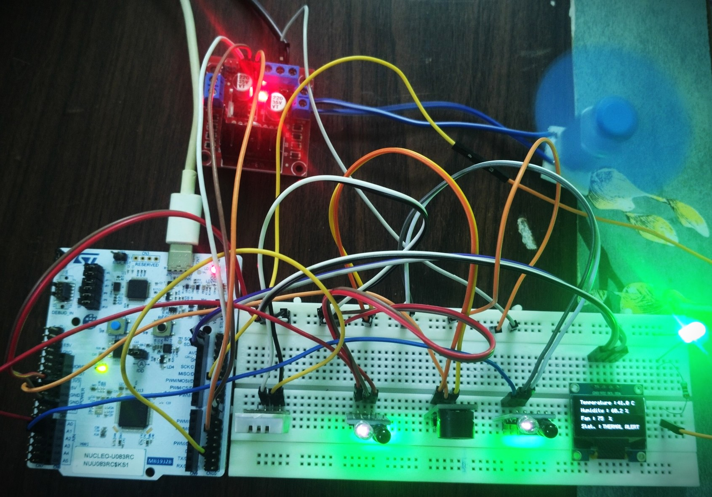
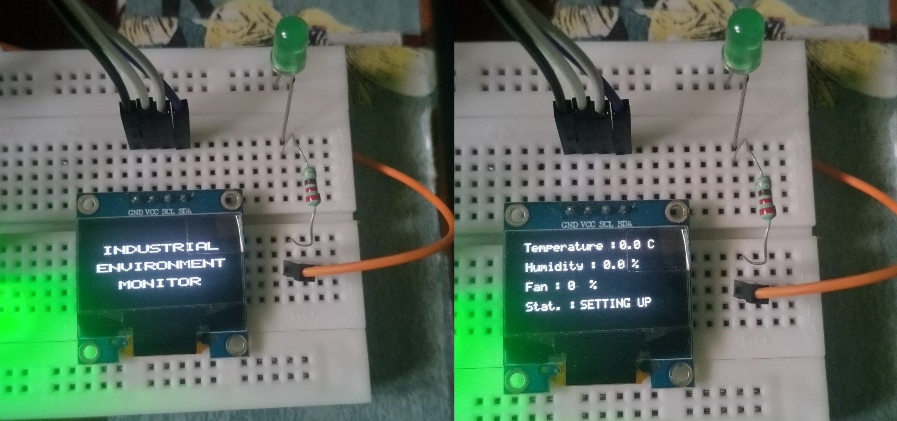
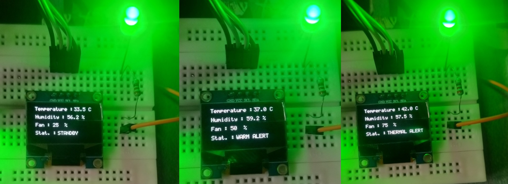
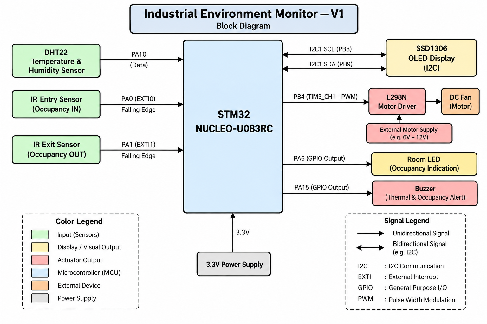

# STM32U083RC Industrial Environment Monitor — V1

Bare-metal environmental monitoring and thermal control system developed on the **STM32 NUCLEO-U083RC** using Embedded C and direct peripheral register programming without STM32 HAL.

V1 integrates temperature and humidity monitoring, occupancy detection, automatic fan control, OLED status display, and audible thermal alerts.

---

## Hardware Setup

  

---

## OLED Output

  

  

---

## System Block Diagram

  

---

## What It Does

- Monitors temperature and humidity using a DHT22 sensor
- Detects visitor entry and exit using two IR sensors
- Tracks room occupancy and controls the room LED
- Displays environmental readings and operating status on an SSD1306 OLED
- Adjusts fan speed according to temperature thresholds
- Activates a buzzer during thermal alerts
- Gives thermal alarms priority over occupancy warnings

---

## Temperature Control

| Temperature | Operating State | Fan PWM |
|---|---|---:|
| < 35°C | STANDBY | 25% |
| 35°C – < 40°C | WARM ALERT | 50% |
| ≥ 40°C | THERMAL ALERT | 75% |

---

## Key Implementation Details

- **FSM architecture** — separates standby, warm-alert, and thermal-alert behavior
- **DHT22 timing** — uses TIM1 for sensor communication timing
- **PWM fan control** — TIM3 generates PWM for the L298N motor driver
- **Buzzer control** — TIM2 generates tones for thermal alerts
- **Interrupt-driven occupancy detection** — EXTI captures IR sensor events
- **Debounce** — SysTick provides millisecond timing for sensor-event filtering
- **OLED interface** — register-level I2C1 driver communicates with the SSD1306

---

## Hardware Pin Mapping

| Function | Pin |
|---|---|
| Entry IR Sensor | PA0 |
| Exit IR Sensor | PA1 |
| Room LED | PA6 |
| DHT22 Data | PA10 |
| Buzzer | PA15 |
| L298N IN1 | PB1 |
| L298N IN2 | PB2 |
| Fan PWM | PB4 / TIM3_CH1 |
| I2C1 SCL | PB8 |
| I2C1 SDA | PB9 |

---

## Peripherals Implemented at Register Level

`GPIO` · `EXTI` · `SysTick` · `TIM1` · `TIM2` · `TIM3` · `PWM` · `I2C1` · `SSD1306 OLED` · `DHT22`

---

## Project Structure

    V1/
    ├── README.md
    ├── Images/
    │   ├── Hardware_Setup.jpg
    │   ├── OLED_Splash.jpg
    │   ├── System_Operating_Modes.jpg
    │   └── Block_Diagram.png
    └── Firmware/
        ├── Sources/
        ├── Startup/
        └── STM32CubeIDE project files

---

## Tools

STM32CubeIDE · ARM GCC · CMSIS · Git · GitHub

---

## Notes

- Bare-metal C with direct peripheral register access; no STM32 HAL
- Fan speed is limited to 75% PWM for stable motor operation
- Thermal alerts trigger buzzer patterns and override occupancy warnings
- Tested on STM32 NUCLEO-U083RC