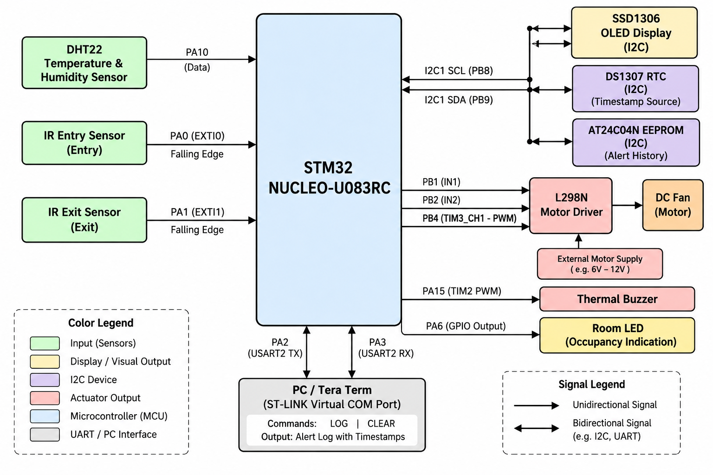
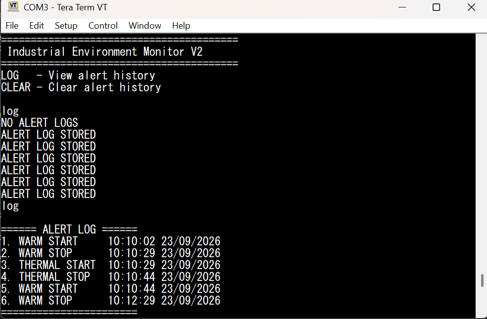

# Industrial Environment Monitor — V2

Register-level STM32U083RC embedded system for environmental monitoring, thermal control, occupancy detection, and persistent alert logging. Built using bare-metal C without STM32 HAL.

V2 extends V1 with DS1307 RTC timestamps, EEPROM-based alert history, and UART commands for log retrieval and clearing.

---

## Hardware Setup

  

---

## System Block Diagram

  

---

## OLED Output

  

---

## UART Alert Log

  

Real alert log output retrieved via `LOG` after triggering temperature threshold transitions using a controlled heat source near the DHT22.

---

## What It Does

- DHT22 monitors temperature and humidity
- IR sensors detect room entry and exit — occupancy count controls room light
- Fan speed controlled by PWM based on temperature FSM state
- Every alert-state transition timestamped via DS1307 RTC and logged to AT24C04N EEPROM
- UART command interface for log retrieval and clearing
- SSD1306 OLED displays live system status

---

## Temperature FSM and Fan Control

| State | Temperature | Fan PWM |
|---|---|---|
| Standby | Below 35°C | 25% |
| Warm Alert | 35°C to 39.9°C | 50% |
| Thermal Alert | 40°C and above | 75% + buzzer |

Thermal alert takes priority over occupancy warning.

---

## Alert Logging

Logged events:

- `WARM START` / `WARM STOP`
- `THERMAL START` / `THERMAL STOP`

Each entry stores the event type and DS1307 timestamp in AT24C04N EEPROM.

`THERMAL STOP → WARM START` is intentional when temperature falls below 40°C but remains above 35°C.

---

## UART Interface

USART2 via ST-LINK Virtual COM Port.

| Command | Action |
|---|---|
| `LOG` | Print stored alert history with timestamps |
| `CLEAR` | Reset alert log |

---

## Hardware Pin Mapping

| Function | Pin |
|---|---|
| Entry IR Sensor | PA0 |
| Exit IR Sensor | PA1 |
| Room LED | PA6 |
| DHT22 | PA10 |
| Buzzer | PA15 |
| L298N IN1 | PB1 |
| L298N IN2 | PB2 |
| Fan PWM | PB4 / TIM3_CH1 |
| I2C SCL | PB8 |
| I2C SDA | PB9 |
| USART2 TX | PA2 |
| USART2 RX | PA3 |

STM32 and L298N share a common ground. The motor uses an external power supply.

---

## Peripherals Implemented at Register Level

`GPIO` · `SysTick` · `EXTI` · `TIM1` · `TIM2 PWM` · `TIM3 PWM` · `I²C1` · `USART2` · `DHT22` · `SSD1306 OLED` · `DS1307 RTC` · `AT24C04N EEPROM`

---

## Project Structure

    V2/
    ├── README.md
    ├── Images/
    │   ├── Hardware_Setup.jpg
    │   ├── System_Operating_Modes.jpg
    │   ├── UART_Alert_Log.jpg
    │   ├── Block_Diagram.png
    │   └── Thermal_Alert.mp4
    └── Firmware/
        ├── Sources/
        ├── Startup/
        └── STM32CubeIDE project files

---

## Tools

STM32CubeIDE · ARM GCC · Git · GitHub

---

## Notes

- Developed and tested on the STM32 NUCLEO-U083RC development board.
- Implemented using bare-metal C with direct register access, without STM32 HAL.
- Temperature thresholds and fan PWM duty cycles are hardcoded in V2.
- Alert history is stored in external AT24C04N EEPROM and survives MCU resets.
- RTC timestamps depend on the DS1307 retaining the correct date and time.
- The fan requires an external motor power supply, with a common ground shared between the STM32 and motor driver.
- V2 extends the Industrial Environment Monitor V1 with timestamped EEPROM logging and UART commands.