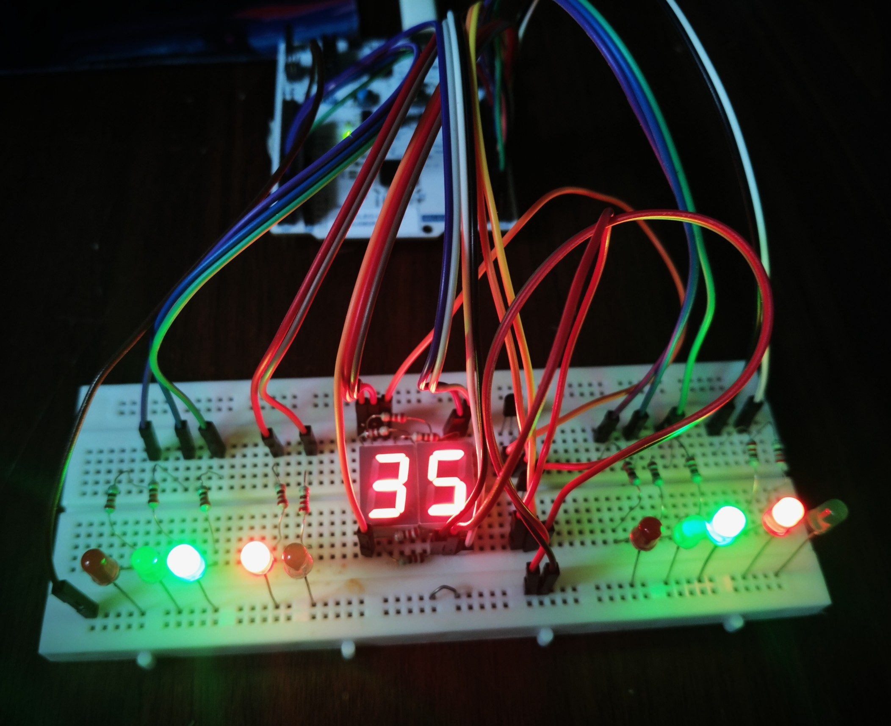
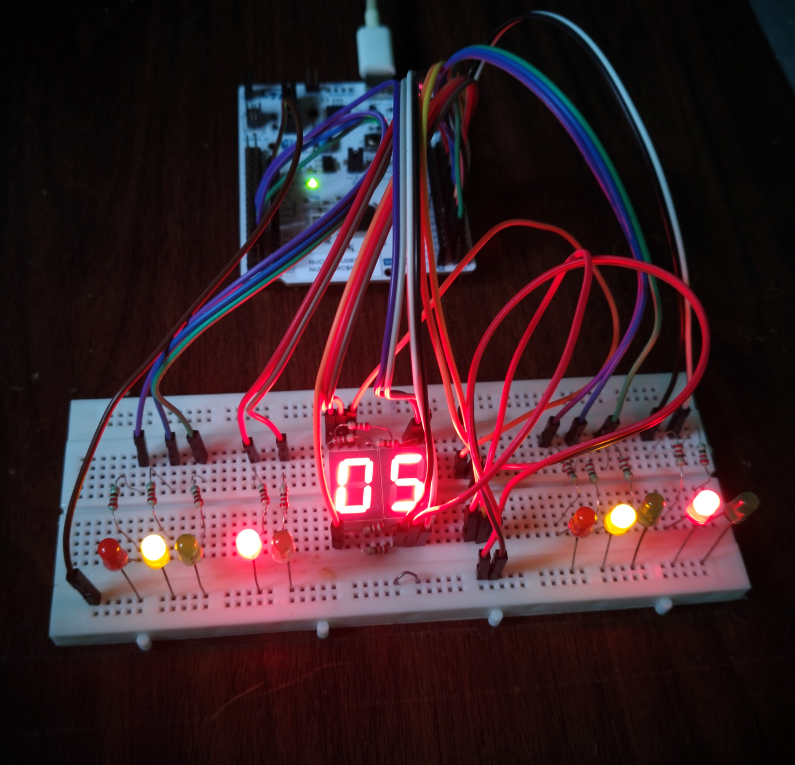
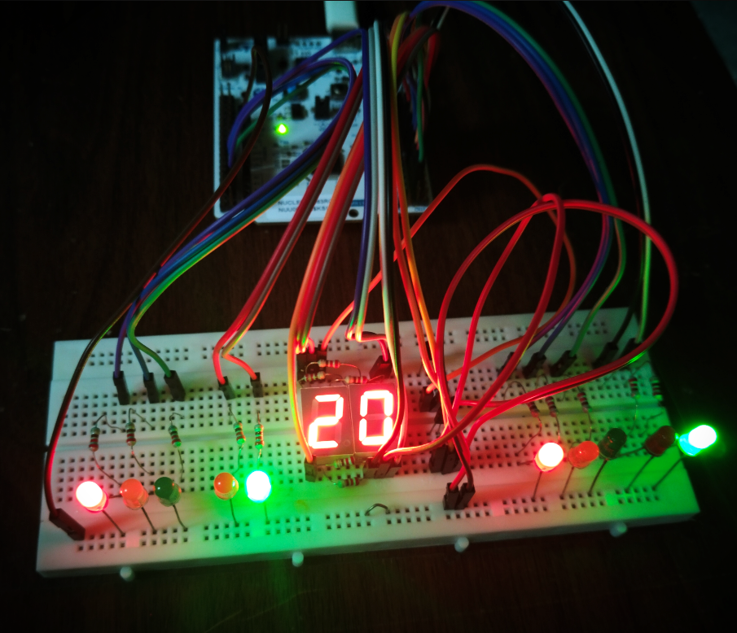
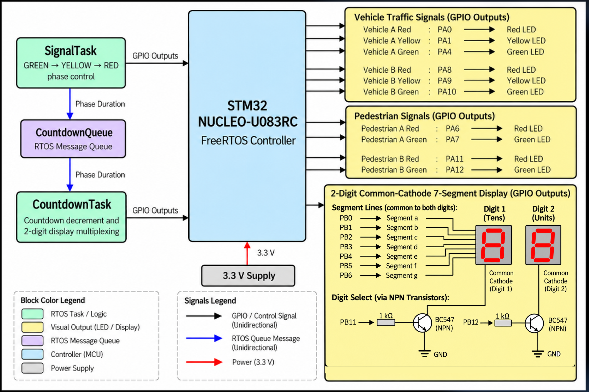

# RTOS-Based Traffic Signal Controller

A FreeRTOS-based traffic signal controller developed using the STM32 NUCLEO-U083RC. The project implements vehicle and pedestrian signal sequencing, inter-task communication using a message queue, and a multiplexed two-digit seven-segment countdown display.

Models a two-way road with a pedestrian crossing: both vehicle directions run the same synchronized phase, and pedestrians cross during vehicle red. A pedestrian waits at most 40 seconds.

---

## Hardware Setup

<p align="center">
  
</p>

---

## Demonstration

[Watch the complete traffic signal cycle](Images/Traffic_Signal_Full_Cycle.mp4)

<table>
  <tr>
    <th align="center">GREEN Phase</th>
    <th align="center">YELLOW Phase</th>
    <th align="center">RED Phase</th>
  </tr>
  <tr>
    <td align="center">
      
    </td>
    <td align="center">
      
    </td>
    <td align="center">
      
    </td>
  </tr>
</table>

---

## System Block Diagram

<p align="center">
  
</p>

---

## Traffic Signal Operation

| Phase | Duration | Vehicle Signals | Pedestrian Signals |
|---|---:|---|---|
| GREEN | 35 seconds | Green | Red |
| YELLOW | 5 seconds | Yellow | Red |
| RED | 20 seconds | Red | Green |

- The sequence repeats continuously: GREEN → YELLOW → RED.
- The countdown display shows the remaining duration of the current phase.
- Vehicle and pedestrian signal LEDs are controlled through GPIO outputs.

---

## FreeRTOS Task Architecture

The application uses two RTOS tasks to separate traffic signal control from countdown display operation.

| Task / Component | Responsibility |
|---|---|
| `SignalTask` | Controls the traffic signal sequence and sends phase durations to the message queue. |
| `CountdownQueue` | Transfers phase duration values (`uint8_t`) from `SignalTask` to `CountdownTask`. |
| `CountdownTask` | Decrements the countdown and updates the multiplexed seven-segment display. |

---

## RTOS Design Notes

- **Producer-consumer pattern**: `SignalTask` produces phase durations, `CountdownTask` consumes them through the queue
- **Blocking receive**: `CountdownTask` sleeps on the queue with `osWaitForever`, so it uses no CPU between phases
- **Independent display timing**: display multiplexing refreshes every 1 ms inside `CountdownTask`, separate from the 35 / 5 / 20 second signal timing
- **Tick-based seconds**: each second is measured from the RTOS tick count, not a software loop
- **Single shared display**: both directions run the same phase, so one seven-segment display shows the countdown for both

---

## Hardware Pin Mapping

### Vehicle Traffic Signals

| Signal | STM32 Pin |
|---|---|
| Vehicle A Red | PA0 |
| Vehicle A Yellow | PA1 |
| Vehicle A Green | PA4 |
| Vehicle B Red | PA8 |
| Vehicle B Yellow | PA9 |
| Vehicle B Green | PA10 |

### Pedestrian Signals

| Signal | STM32 Pin |
|---|---|
| Pedestrian A Red | PA6 |
| Pedestrian A Green | PA7 |
| Pedestrian B Red | PA11 |
| Pedestrian B Green | PA12 |

### Seven-Segment Display

| Display Connection | STM32 Pin |
|---|---|
| Segment a | PB0 |
| Segment b | PB1 |
| Segment c | PB2 |
| Segment d | PB3 |
| Segment e | PB4 |
| Segment f | PB5 |
| Segment g | PB6 |
| Tens Digit Select | PB11 |
| Units Digit Select | PB12 |

The display is a two-digit common-cathode seven-segment display. Two BC547 NPN transistors provide digit selection for multiplexing.

---

## Tools and Technologies

- **Microcontroller:** STM32U083RC on STM32 NUCLEO-U083RC
- **IDE / Configuration:** STM32CubeIDE, STM32CubeMX
- **Language:** C
- **RTOS:** FreeRTOS (CMSIS-RTOS2)
- **Hardware Abstraction:** STM32 HAL
- **Version Control:** Git and GitHub

---

## Project Structure

```text
Traffic_Signal_Controller_RTOS/
├── Firmware/
│   ├── Core/
│   │   ├── Inc/
│   │   └── Src/          app_freertos.c, SevenSeg.c
│   └── Traffic_Signal_Controller_RTOS.ioc
├── Images/
└── README.md
```

---

## Possible Extension

Demand-actuated pedestrian crossing: an EXTI request button notifying `SignalTask` through a task notification, to shorten the next green phase.