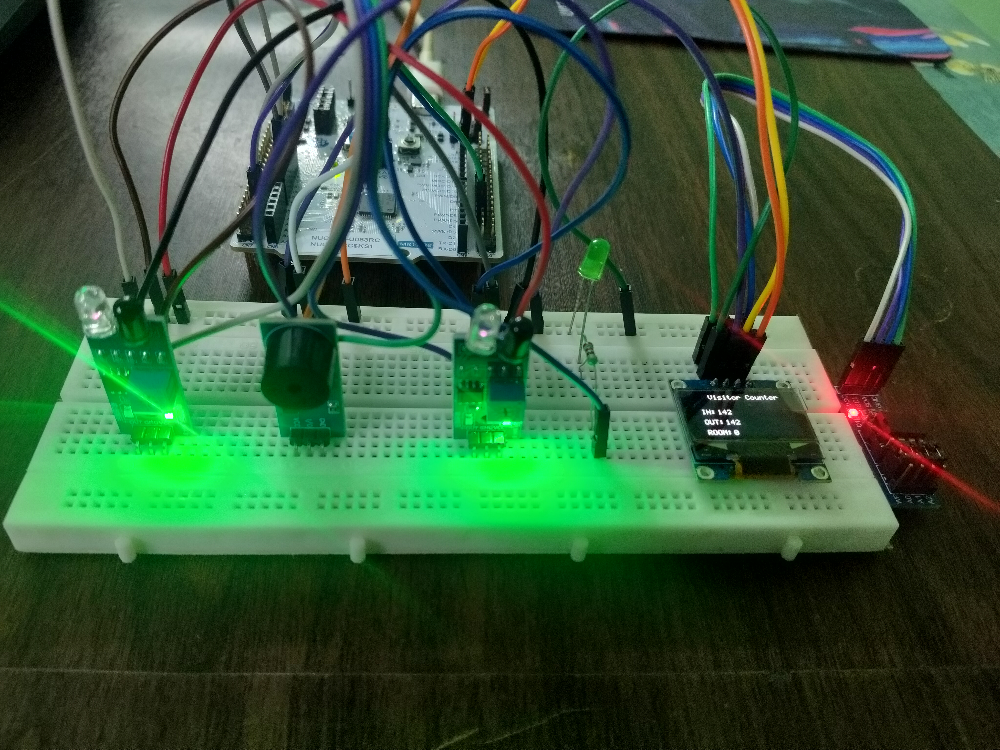
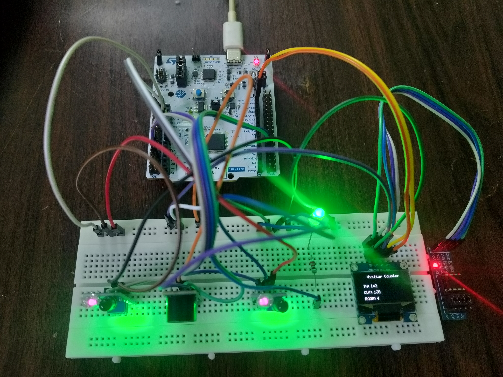
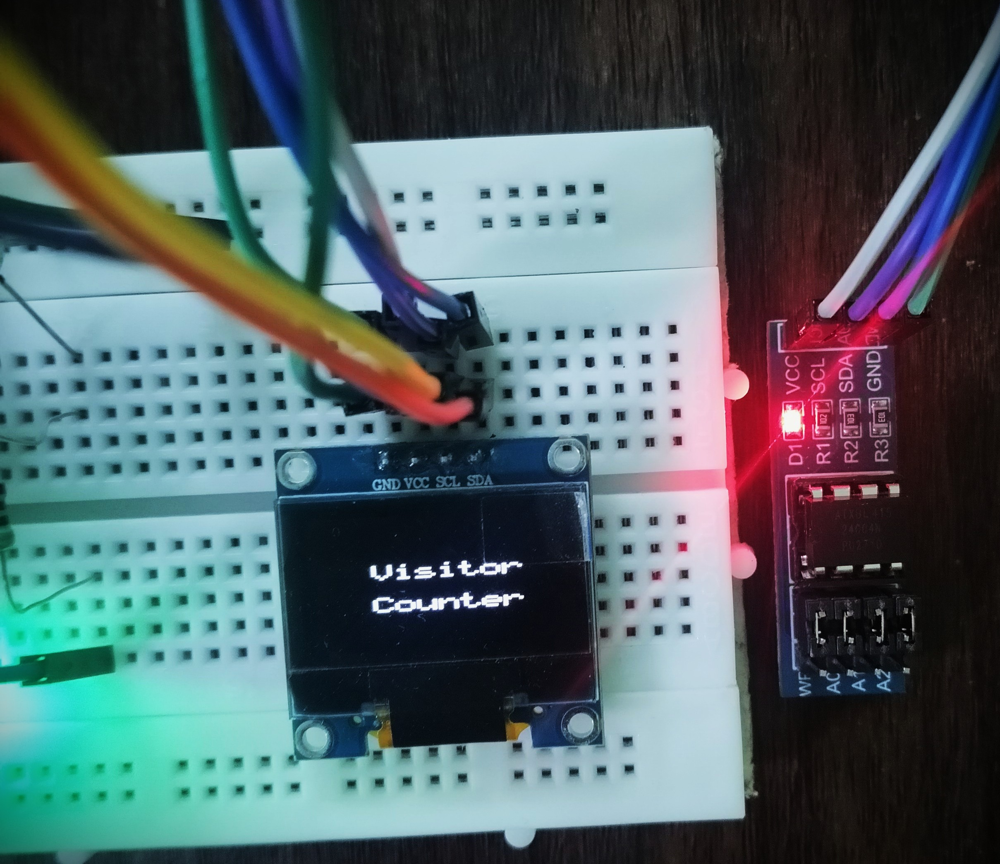
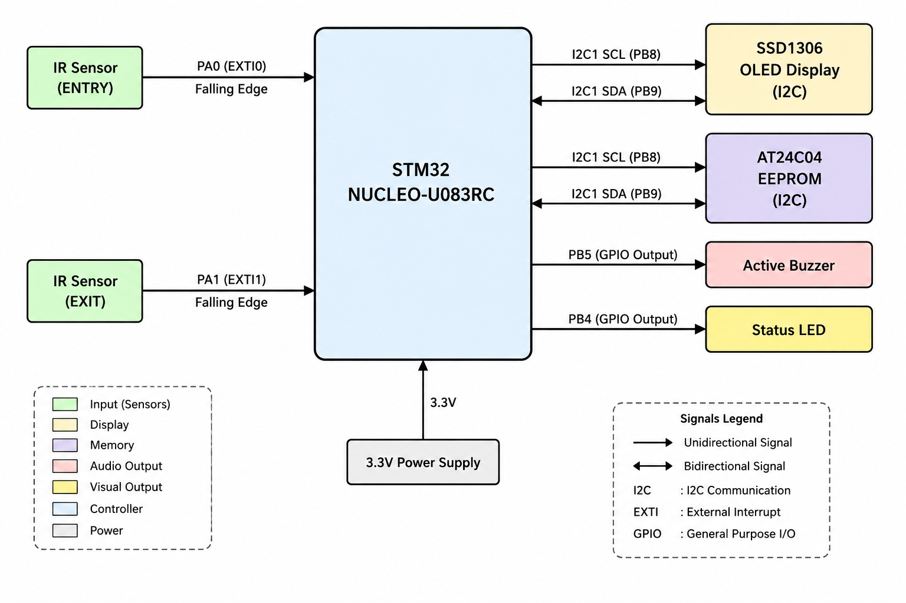

# STM32U083RC Visitor Counter — V1

Register-level visitor counter system on the **STM32 NUCLEO-U083RC** using bare-metal C without STM32 HAL.

---

## Hardware Setup

---

## OLED Output

---

## System Block Diagram

---

## What It Does

- Detects visitor entry and exit using two IR sensors via EXTI falling-edge interrupts
- Tracks entry count, exit count, and current room occupancy
- Displays live counts on 128×64 SSD1306 OLED
- Persists visitor count to AT24C04 EEPROM — count survives reset and power cycle
- LED indicates room occupancy status
- Buzzer provides audible feedback on each visitor event

---

## Key Implementation Details

- **EXTI interrupt handling** — IR sensors trigger falling-edge interrupts; ISR sets event flags, main loop processes counts to keep ISR minimal
- **Software debounce** — 150ms debounce using SysTick millisecond counter prevents false triggers
- **I²C1 master driver** — custom register-level driver handles both SSD1306 OLED and AT24C04 EEPROM on the same bus
- **EEPROM persistence** — 16-bit visitor count written on every event; restored on power-up via write-cycle polling
- **5×7 ASCII font** — custom font table with scaled character rendering for OLED display

---

## Hardware

| Peripheral | Pin | Function |
|---|---|---|
| IR Entry Sensor | PA0 | EXTI0 falling-edge input |
| IR Exit Sensor | PA1 | EXTI1 falling-edge input |
| Status LED | PB4 | GPIO output |
| Active Buzzer | PB5 | GPIO output |
| I²C SCL | PB8 | I2C1 clock |
| I²C SDA | PB9 | I2C1 data |

---

## Peripherals Implemented at Register Level

`GPIO` · `SysTick` · `EXTI` · `I²C1` · `SSD1306 OLED` · `AT24C04 EEPROM`

---

## Project Structure

    Visitor_Counter/
    └── V1/
        ├── README.md
        ├── Images/
        └── Firmware/
            ├── Sources/
            └── Startup/

---

## Tools

STM32CubeIDE · ARM GCC · Git · GitHub

---

## Notes

- No STM32 HAL — direct peripheral register access throughout
- SysTick provides 1ms time base for debounce and delays
- I²C timing register configured for STM32U083RC at 4MHz system clock
- Tested on STM32 NUCLEO-U083RC