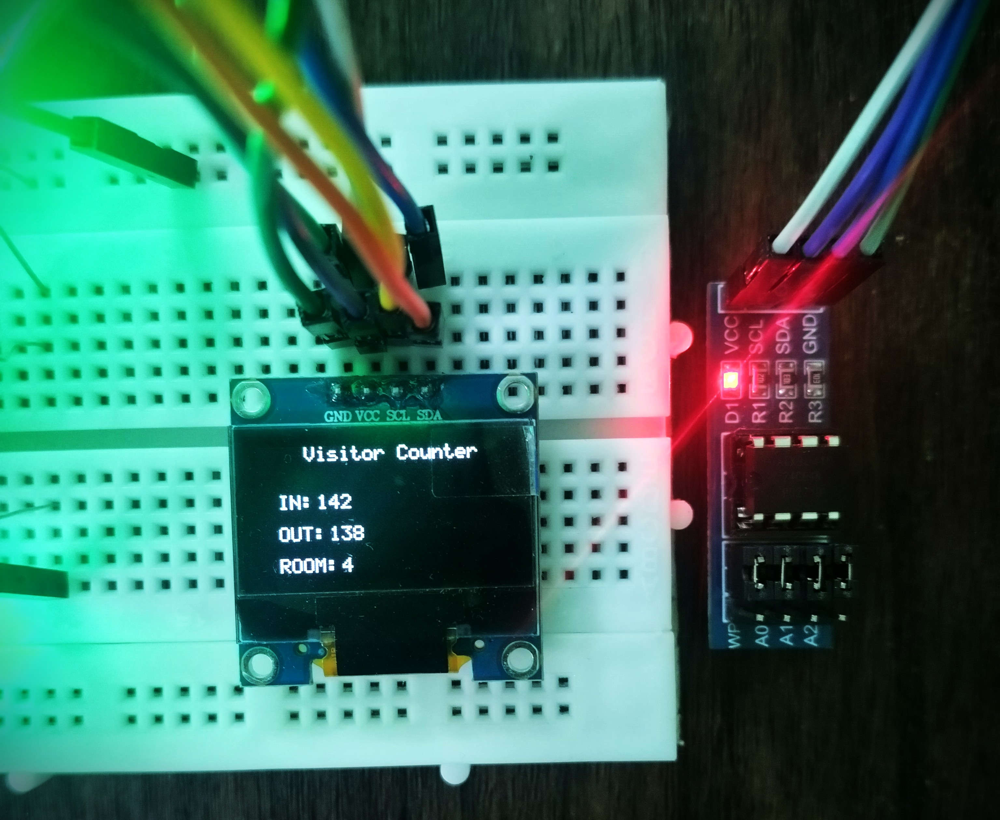
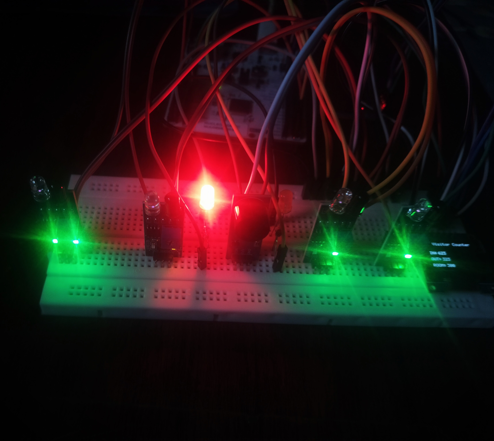
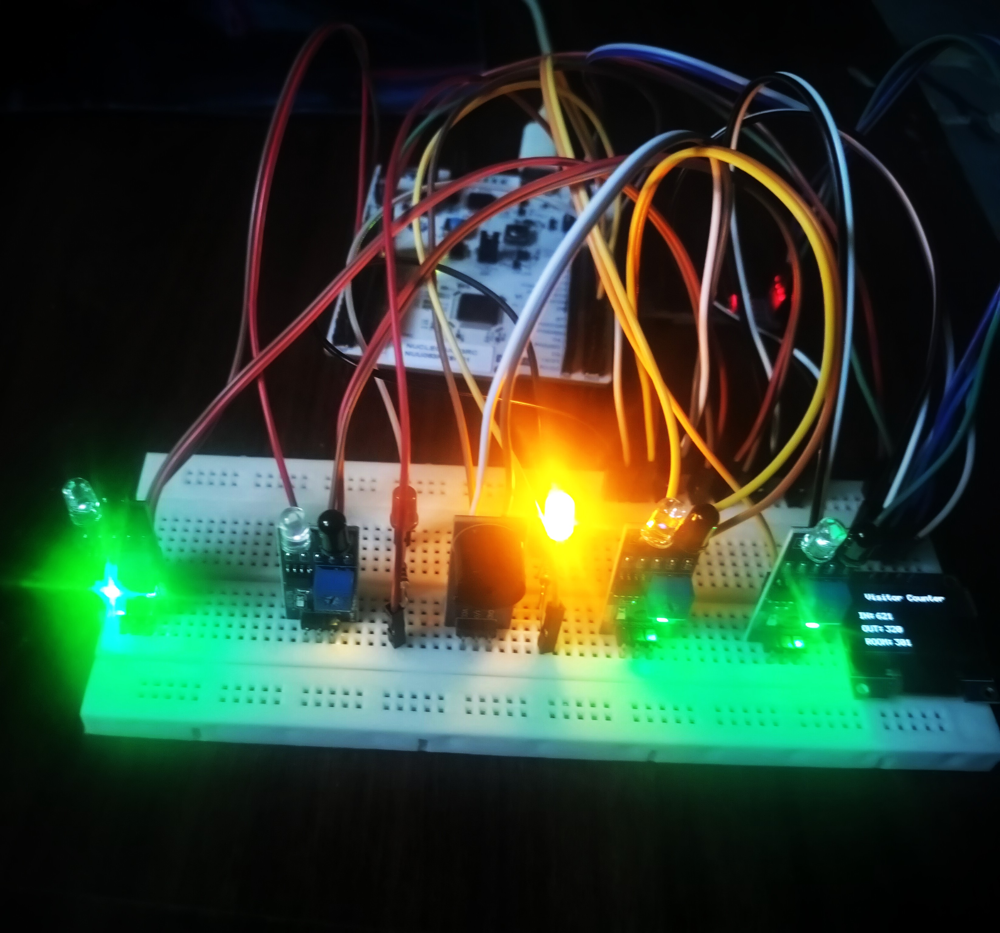
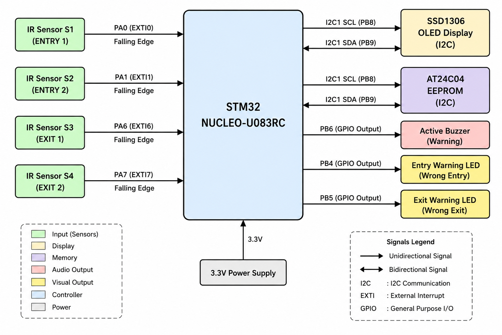

# STM32U083RC Visitor Counter — V2

Register-level visitor counter with FSM-based direction detection on the **STM32 NUCLEO-U083RC** using bare-metal C without STM32 HAL.

V2 replaces basic IR detection with a four-sensor FSM that validates visitor movement direction and detects wrong-direction attempts.

---

## Hardware Setup

  

---

## OLED Output

  

  

---

## Warning LEDs

  

  

---

## System Block Diagram

  

---

## What Changed from V1

| V1 | V2 |
|---|---|
| 2 IR sensors, basic counting | 4 IR sensors, FSM direction detection |
| No direction validation | Wrong-direction detection and warning |
| Simple sensor events | Sensor sequence validation with timeout |
| Basic debounce | Per-sensor debounce + re-arm mechanism |

---

## What It Does

- Detects entry and exit using four IR sensors in sequence-validated pairs
- FSM determines movement direction from sensor trigger order — S1→S2 valid entry, S2→S1 wrong direction
- Tracks entry count, exit count, and current room occupancy
- Wrong-direction events trigger warning LED and buzzer
- Persists counts to AT24C04 EEPROM — restored on power cycle
- Displays live counts on SSD1306 OLED

---

## Key Implementation Details

- **FSM architecture** — five states: `FSM_IDLE`, `FSM_ENTRY_S1`, `FSM_ENTRY_S2`, `FSM_EXIT_S3`, `FSM_EXIT_S4`. Incomplete sequences timeout after 2000ms and return to IDLE
- **ISR flag pattern** — interrupt handlers only set sensor flags; all FSM logic runs in main loop context keeping ISRs minimal
- **Sensor re-arm** — sensor disarmed after trigger until beam clears again, prevents repeated events from sustained blockage
- **Per-sensor debounce** — 500ms independent debounce per sensor via SysTick counter
- **EEPROM persistence** — counts stored at fixed addresses, restored on startup, present count derived as InCount minus OutCount

---

## FSM State Flow

    FSM_IDLE
        ├── S1 → FSM_ENTRY_S1 → S2 = Valid Entry
        ├── S2 → FSM_ENTRY_S2 → S1 = Wrong Entry (warning)
        ├── S3 → FSM_EXIT_S3  → S4 = Valid Exit
        └── S4 → FSM_EXIT_S4  → S3 = Wrong Exit (warning)

---

## Hardware

| Function | Pin |
|---|---|
| Entry Sensor 1 — S1 | PA0 |
| Entry Sensor 2 — S2 | PA1 |
| Exit Sensor 1 — S3 | PA6 |
| Exit Sensor 2 — S4 | PA7 |
| Entry Warning LED | PB4 |
| Exit Warning LED | PB5 |
| Buzzer | PB6 |
| I²C1 SCL | PB8 |
| I²C1 SDA | PB9 |

---

## Peripherals Implemented at Register Level

`GPIO` · `SysTick` · `EXTI` · `I²C1` · `SSD1306 OLED` · `AT24C04 EEPROM`

---

## Project Structure

    V2/
    ├── README.md
    ├── Images/
    │   ├── Hardware_Setup.jpg
    │   ├── OLED_Splash.jpg
    │   ├── OLED_Count.jpg
    │   ├── Entry_Warning_LED.jpg
    │   ├── Exit_Warning_LED.jpg
    │   └── Block_Diagram.png
    └── Firmware/
        ├── Sources/
        │   ├── main.c
        │   ├── FSM.c / FSM.h
        │   ├── EXTI.c / EXTI.h
        │   ├── gpio.c / gpio.h
        │   ├── i2c.c / i2c.h
        │   ├── EEPROM.c / EEPROM.h
        │   ├── ssd1306.c / ssd1306.h
        │   ├── display.c / display.h
        │   ├── font5x7.c / font5x7.h
        │   └── SysTick.c / SysTick.h
        └── Startup/

---

## Tools

STM32CubeIDE · ARM GCC · Git · GitHub

---

## Notes

- No STM32 HAL — direct peripheral register access throughout
- SysTick 1ms time base used for debounce, FSM timeout, and warning duration
- Both OLED and EEPROM share I²C1 bus on PB8/PB9
- Present count protected from underflow on exit events
- Tested on STM32 NUCLEO-U083RC