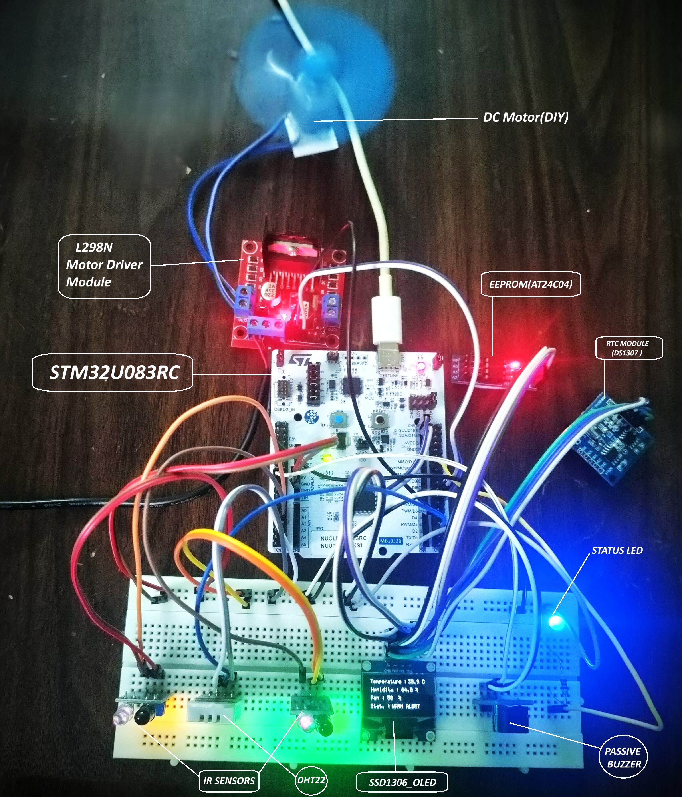
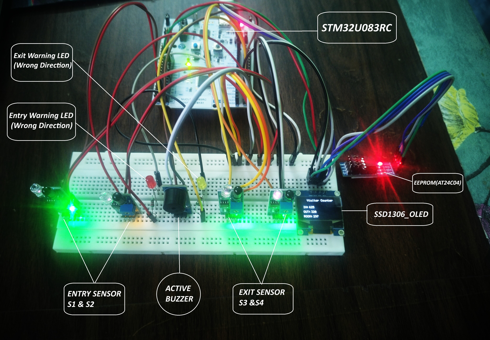
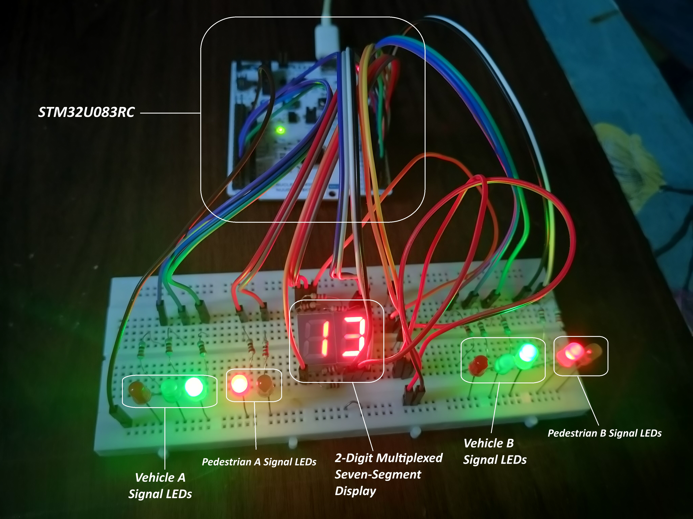

# STM32U083RC — Embedded Systems Projects & Drivers

Embedded firmware on the **STM32 NUCLEO-U083RC**: register-level drivers, complete multi-peripheral applications, and an RTOS project. The repository progresses from individual peripheral drivers to full applications.

**Bare-metal projects:** C · direct register programming · modular drivers · no HAL  
**RTOS project:** FreeRTOS (CMSIS-RTOS2) with STM32 HAL  
**Tools:** STM32CubeIDE · ARM GCC · CMSIS · Tera Term · Git

---

## Projects

### Industrial Environment Monitor

Temperature, humidity and occupancy monitoring with PWM fan control, FSM-based alert states and persistent event logging.

  

| Version | What it adds |
|---|---|
| V1 | DHT22 + IR occupancy + PWM fan + FSM + OLED |
| V2 | DS1307 RTC + EEPROM alert logging + UART log interface |

- Temperature FSM: Standby / Warm Alert / Thermal Alert with PWM fan response
- V2 logs every alert transition with an RTC timestamp to EEPROM
- UART `LOG` and `CLEAR` commands for alert history

📁 [`Projects/Industrial_Environment_Monitor`](Projects/Industrial_Environment_Monitor)

---

### Visitor Counter

IR-based visitor counting with FSM direction detection, EEPROM persistence and wrong-direction warning.

  

| Version | What it adds |
|---|---|
| V1 | 2 IR sensors + EXTI counting + OLED + EEPROM persistence |
| V2 | 4 IR sensors + FSM direction detection + wrong-direction warning |

- V2 FSM validates sensor order: S1→S2 is a valid entry, S2→S1 is wrong direction
- Per-sensor debounce, re-arm mechanism and a 2000 ms sequence timeout
- Warning LED and buzzer on wrong-direction detection

📁 [`Projects/Visitor_Counter`](Projects/Visitor_Counter)

---

### Traffic Signal Controller (FreeRTOS)

Two-way road signal with pedestrian crossing. One task runs the signal sequence, another runs a multiplexed two-digit countdown display, linked by a message queue.

  

- Two RTOS tasks with a producer-consumer message queue
- Countdown display refresh runs independently of the 35 / 5 / 20 second signal phases
- Vehicle and pedestrian signalling for both directions

📁 [`Projects/Traffic_Signal_Controller_RTOS`](Projects/Traffic_Signal_Controller_RTOS)

---

## Drivers

Standalone register-level drivers written as reusable modules before being used in the projects above.

| Driver | What it covers |
|---|---|
| [`UART + GPIO + Motor`](Drivers/UART_GPIO_MOTOR) | USART2 command interface, GPIO control, L298N motor control |
| [`I2C + SSD1306 OLED`](Drivers/I2C_SSD1306_OLED) | I2C1 master driver, SSD1306 display, 5×7 ASCII font |
| [`Sensor Drivers`](Drivers/STM32_Sensor_Drivers) | DHT22 and HC-SR04 with TIM3 µs timing, checksum validation, timeouts |
| [`EXTI`](Drivers/EXTI) | GPIO-to-EXTI mapping, edge trigger, NVIC, ISR handling |
| [`Seven-Segment Multiplexing`](Drivers/SevenSeg_Multiplexing) | Two-digit display 00 to 99, BC547 digit select, SysTick 1 ms refresh |

---

## Peripherals Covered

`GPIO` · `EXTI` · `NVIC` · `SysTick` · `TIM1` · `TIM2` · `TIM3` · `PWM` · `USART2` · `I²C1` · `DHT22` · `HC-SR04` · `SSD1306 OLED` · `AT24C04N EEPROM` · `DS1307 RTC` · `IR Sensors` · `L298N Motor Driver` · `Seven-Segment Display` · `FreeRTOS`